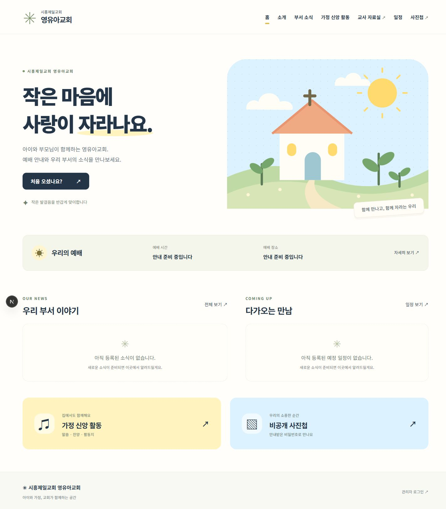

# 시흥제일교회 영유아교회

PRD 1.0에 맞춘 Next.js · TypeScript · Supabase 홈페이지입니다. 화면 너비에 맞춰 본문, 여백, 글자, 카드 배치가 변하는 유동형 레이아웃을 사용합니다.

## 현재 상태



[휴대폰 화면 미리보기](docs/preview/home-mobile.png)

- 공개 화면 5개: 홈, 소개, 부서 소식, 가정 신앙 활동, 일정
- 비공개 화면 2개: 교사 자료실, 사진첩
- 관리자 개인 로그인, 비밀번호 재설정, 전체 콘텐츠 편집, 초안/게시, 검토 확인, 동시 수정 충돌 방지
- 교사/사진첩 비밀번호 분리, 서버 접근 검사, 12시간 서명 쿠키, 비밀번호 변경 시 세션 무효화
- 파일 형식/크기 검사, 비공개 파일, 권한 확인 후 60초 서명 링크, 사진 EXIF 제거 및 썸네일
- 목록/달력, 활동 기준 날짜 필터, 사진 확대/이전/다음/개별 내려받기

**실제 Supabase 연결과 관리자 계정은 제공되지 않았습니다.** 연결 전에는 공개 화면의 빈 상태와 잠금 화면을 볼 수 있습니다. 실제 소식, 성경/교리 내용, 예배 정보, 사진은 예시로 생성하거나 게시하지 않습니다. 이 저장소를 공개하는 것과 홈페이지를 인터넷에 배포하는 것은 별개입니다.

## 로컬 실행

Node.js 22 이상과 pnpm을 사용합니다. 의존성 버전은 `pnpm-lock.yaml`에 고정되어 있습니다.

```sh
pnpm install --frozen-lockfile
pnpm dev
```

브라우저에서 `http://127.0.0.1:3000`을 엽니다. 서비스 연결 전에도 화면 구조를 확인할 수 있습니다.

```sh
pnpm test
pnpm typecheck
pnpm build
pnpm start
```

## 실제 운영 준비

[운영 안내](docs/운영안내.md)의 순서를 따라 Supabase와 Vercel을 설정하세요. `.env.example`을 `.env.local`로 복사해 값을 입력합니다. 실제 환경 변수 파일은 Git에 포함하지 않습니다.

| 환경 변수                       | 용도                                                           |
| ------------------------------- | -------------------------------------------------------------- |
| `NEXT_PUBLIC_SUPABASE_URL`      | Supabase 프로젝트 URL                                          |
| `NEXT_PUBLIC_SUPABASE_ANON_KEY` | 공개용 anon/publishable 키                                     |
| `SUPABASE_SERVICE_ROLE_KEY`     | 서버에서만 사용하는 service_role 비밀키                        |
| `SESSION_SECRET`                | 32바이트 이상 무작위 세션 서명 비밀값                          |
| `APP_URL`                       | 로컬 주소 또는 실제 HTTPS 도메인, Origin 검사와 인증 복귀 주소 |

서버 비밀키에 `NEXT_PUBLIC_` 접두사를 붙이지 마세요. GitHub, PRD, 채팅, 브라우저 코드에 실제 비밀번호·비밀키를 적지 마세요.

## 구조

```text
src/app/                 이용자 화면, 관리자, 서버 API
src/components/          공통 UI와 관리자 편집기
src/lib/                 인증, 조회, 검증, 파일 처리
supabase/migrations/     테이블, 권한, 트랜잭션 함수
tests/                   보안, 파일, PostgreSQL 검증
docs/                    구현 계획, 운영 및 검증 안내
```

공개용 파일도 private 버킷을 사용합니다. `/api/files/[id]`에서 게시 상태와 권한을 확인한 뒤 짧은 서명 URL로 연결합니다. 업로드는 Vercel 본문 제한을 피하기 위해 private 임시 버킷으로 직접 전송하고, 서버 검증을 통과한 파일만 콘텐츠에 연결합니다. 일반 브라우저와 로그인 계정은 데이터베이스를 직접 읽거나 변경할 수 없습니다.

## 검증 범위

실제 PostgreSQL 엔진인 PGlite에서 스키마, RLS/실행 권한, 검토, 동시 수정, 비밀번호 버전과 요청 제한을 검사합니다. 사진 변환, 위장 파일 차단, 세션의 공간 분리·변조·만료도 테스트합니다. 이 테스트가 Supabase Auth/Storage 또는 Vercel 운영 통합 테스트를 대체하지는 않습니다. 배포 전 [검증 기록](docs/검증기록.md)의 연결 후 시나리오를 확인하세요.

기술 문서는 [Next.js 설치 안내](https://nextjs.org/docs/app/getting-started/installation), [Supabase 서버 인증 안내](https://supabase.com/docs/guides/auth/server-side), [Supabase SSR 클라이언트 안내](https://supabase.com/docs/guides/auth/server-side/creating-a-client)를 참고했습니다.
